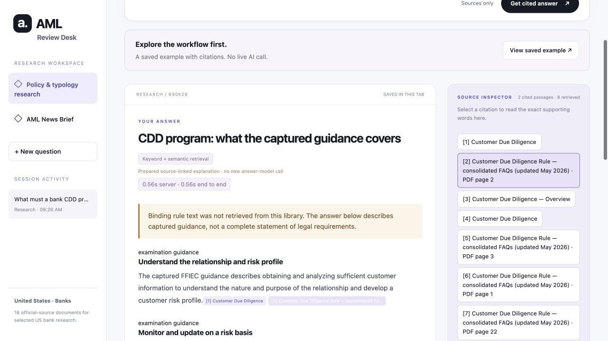

# AML Review Desk

[Try the app](https://aml-review-desk-himani.replit.app)

I built AML Review Desk to explore how AI could help with a practical part of risk work: finding relevant AML guidance, understanding it, and checking the evidence behind an answer.

Coming from risk management, I wanted to be able to challenge the output. Which document supports this statement? Is it a regulatory requirement or examination guidance? What information is missing? Those questions shaped the app as much as the choice of model or database.

This is a portfolio project and a working research prototype, focused on US banking. I used AI coding assistance during development. The source choices, retrieval comparisons, failed examples and remaining gaps are documented in this repository.

## What you can do

**Research an AML question.** Ask about customer controls or a laundering pattern, read the answer, and select a numbered citation to inspect the supporting passage. You can also search sources without generating an AI answer, add your assessment, and export your notes.

Questions to try:

- How do customer identification, CDD and EDD fit together?
- What should an analyst investigate in a possible money-mule account?
- What evidence would help assess a bank's AML risk assessment?

**Read an AML News Brief.** Browse selected official updates from FinCEN, OCC, the Federal Reserve, FDIC, NCUA, SEC and CFTC. Filter by month, dates or agency, then open a story for what happened, why it may matter for AML, and findings from linked regulator PDFs when available.

There is no sign-up. Research and notes stay in the browser tab across refreshes. Export anything you want to keep beyond that session.



## How it works

The research feature uses hybrid retrieval-augmented generation (RAG). It searches the captured source library before asking the model to write an answer.

```text
Question
   ├── BM25: find matching words and phrases
   └── Embeddings + Pinecone: find similar meaning
                         ↓
              Combine the ranked results
                         ↓
             Give source passages to the model
                         ↓
          Check citation IDs and quoted evidence
                         ↓
           Answer + selectable source passages
```

BM25 helps with specific terms and names. Vector search helps when a question uses different wording from the source. Reciprocal rank fusion combines the two result lists, and the model receives up to eight passages. If vector search is unavailable, the app falls back to keyword search and tells the user.

The current library contains **18 documents, 231 source passages and 356 embedding windows**. Documents are split into roughly 450-word windows with 60-word overlap for vector search; citations take the reader back to the original passage and its locator.

The app rejects unknown citation IDs and checks that selected quotes exist in the retrieved material. That catches some errors, but a matching quote does not prove that the model interpreted it correctly. Reviewing the claim is still necessary.

One narrow question—what a bank CDD program should include—has a labelled, prepared explanation tied to retrieved FinCEN and FFIEC passages. That path makes no new answer-model call. It is a reference response, not a fresh generation result or a complete legal checklist.

News follows a separate path: official feeds and announcement pages, followed by a summary of the selected story and available linked PDFs. It does not currently search a vector database of news.

| Part | What I used |
| --- | --- |
| Interface | HTML, CSS and JavaScript |
| Python backend | Flask, with Gunicorn for hosting |
| Answer generation | Nebius: `Qwen/Qwen3-30B-A3B-Instruct-2507` |
| Embeddings | Nebius: `Qwen/Qwen3-Embedding-8B`, 1,024 dimensions |
| Vector storage | Pinecone Database |
| Keyword search and rank fusion | Python implementation in this repository |
| PDF extraction | pypdf |
| Hosting and checks | Replit; GitHub Actions for automated tests |

The Python dependencies are in [requirements.txt](requirements.txt). Provider clients use Python's standard library; this version does not require LangChain or LlamaIndex.

## What the testing showed

I compared BM25, vector search and hybrid retrieval rather than assuming hybrid would be best.

| Question set | BM25 Hit @ 5 | Vector Hit @ 5 | Hybrid Hit @ 5 |
| --- | ---: | ---: | ---: |
| Development: 24 questions | 100.0% | 95.8% | 100.0% |
| Paraphrase challenge: 12 questions | 25.0% | 91.7% | 83.3% |

Hit @ 5 means at least one labelled relevant passage appeared in the first five results. **Vector search beat hybrid on the paraphrase set.** Combining methods helped compared with keyword search, but did not automatically produce the best ranking.

These results come from an earlier corpus version. They have not been rerun as a benchmark for the latest FAQ and routing update. The relevance labels were prepared during development, with AI assistance, and have not been independently reviewed by an AML expert. These are retrieval results, not answer-accuracy percentages.

The repository also has **93 passing software tests**, covering retrieval, citation handling, source checksums, public routes, request limits and other application behavior. GitHub Actions runs the tests on pushes and pull requests.

Latency was a real problem during testing. After reducing the model context and switching the answer model, four live generated-answer checks took **2.9–6.4 seconds server-side**. That is a small sample; it excludes hosting startup and browser overhead. The app shows retrieval, drafting and checking progress against an eight-second target. Slow first visits still need a controlled cold-start investigation.

Five initial adversarial probes passed, including two live tests with instructions planted in retrieved evidence. This is limited prompt-injection testing, not a comprehensive jailbreak assessment.

The evidence is available to inspect:

- [Retrieval comparison](reports/retrieval_comparison.json), [challenge questions](evaluation/hybrid_challenge.json) and [label correction](evaluation/label_revision.json)
- [Generated-answer spot checks](reports/revision_final_answers.json) and [adversarial probes](reports/adversarial_checks.json)
- [Latest source update](reports/current_source_revision.json) and [source coverage](reports/aml_typology_coverage.json)

## What still needs work

The most important gap is **binding rule coverage**. The library includes FinCEN's consolidated CDD FAQs, updated May 2026, and FFIEC guidance, but it does not yet include direct CFR rule text. The app discloses that gap when answering requirements questions. FAQs, examination guidance and historical testimony are not interchangeable with the underlying law.

The seven topic shortcuts are selected research areas, not a complete AML taxonomy. They mix laundering methods, channels and underlying crimes. Other areas—including underground banking, real estate and gambling—still need dedicated source and answer validation. Historical documents remain dated; ordinary customer-control searches no longer prioritize the 2014 KYC testimony.

News coverage is also incomplete. The app starts with saved entries and checks official feeds in the background, using a shared one-hour cache. It does not collect news overnight while nobody is using it, and an empty month does not mean no AML news was published. Linked PDF reading is limited to two documents, 6 MB each and the first 50 pages; scanned PDFs need OCR.

Independent answer review, broader adversarial testing and multi-user load testing remain open. The app supports research and reviewer judgment; it does not certify compliance, determine that a customer is laundering money, or make SAR-filing decisions.

## Run it locally

Use Python 3.10 or newer. From the project folder:

```bash
python3 -m venv .venv
source .venv/bin/activate
pip install -r requirements.txt

python3 configure.py
python3 configure.py --pinecone
python3 src/aml_research.py build
python3 src/hybrid_retrieval.py prepare
python3 src/hybrid_retrieval.py sync
python3 app.py
```

Open `http://127.0.0.1:8000/`. The configuration scripts ask for keys through hidden prompts and save them to `.env`, which Git ignores. Keep real keys out of `.env.example` and source files.

For your own setup, use a Pinecone index you control. Embedding preparation and sync use your provider accounts and may consume credits. Cached embeddings are reused; older index namespaces are retained until deliberately removed.

To run the software tests:

```bash
python3 -m unittest discover -s tests -q
```

To rerun retrieval comparisons or generate answer samples:

```bash
python3 src/evaluate_hybrid.py
python3 src/evaluate_hybrid.py --answers
```

Those evaluation commands use live services; uncached answer comparisons make six generation calls. Regenerated reports describe your run, not necessarily the historical results above.

For hosting settings, request limits and deployment steps, see [DEPLOYMENT.md](DEPLOYMENT.md). Caching and request limits help control usage, but they are not a guaranteed spending cap. Live answers and new news briefs need funded provider access; the saved example and keyword-only source search remain useful when model credits run out.
